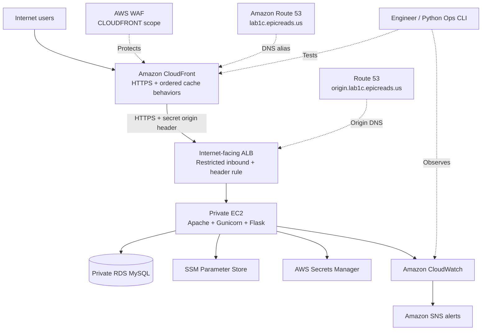

# AWS Armageddon — Lab 2: Secure CloudFront Delivery & Cache Correctness

**A hands-on AWS Cloud/DevOps engineering project built with Terraform, Python, and operational testing.**


**AWS Region:** `us-east-1` (application infrastructure and CloudFront-related ACM/WAF configuration)

**Public application hostname:** `https://lab1c.epicreads.us`

**Origin hostname:** `origin.lab1c.epicreads.us` — protected ALB origin, **not** a public application URL

---

## 1. Project overview

This project extends **AWS Armageddon Lab 1C** into a more realistic application-delivery architecture. Instead of allowing customers to access an Application Load Balancer (ALB) directly, I placed **Amazon CloudFront and AWS WAF in front of it**. I then configured different caching rules for public static files and dynamic database-backed API responses.

The project has three related parts:

- **Lab 2A — Origin cloaking:** Make CloudFront the intended public entry point; restrict the ALB using the AWS-managed CloudFront origin-facing prefix list and a secret origin verification header.
- **Lab 2B — Cache correctness:** Cache safe `/static/*` responses, but disable caching for `/api/*` and unmatched routes so users receive fresh dynamic data.
- **Python operations:** Use repeatable scripts to inspect CloudWatch alarms and logs, test CloudFront behavior, and verify origin protection.

**Main engineering lesson:** A successful `terraform apply` proves resources were provisioned; it does **not** prove that the application is secure, functional, or returning correct data. That requires end-to-end tests and evidence.

## 2. The client's business problem

Imagine a client operates an event-booking, retail, or customer-service application. It serves public assets (images, CSS, documents) and dynamic API responses (customer information, orders, reservations, or account status). The client wants the website to remain responsive while protecting its backend and avoiding unnecessary cloud spending.

| Business problem | Risk if ignored | Engineering response | Value to the client |
|---|---|---|---|
| Customers bypass CloudFront and contact the ALB directly | Edge security controls can be bypassed | Restrict ALB ingress and require a custom origin header | Consistent security enforcement |
| Unwanted or abusive web requests reach the backend | Higher load, incidents, and support burden | Attach AWS WAF to CloudFront | Earlier filtering before requests reach the application |
| Every request for a public asset hits EC2 | More origin traffic and slower delivery | Cache eligible `/static/*` files at the edge | Better performance and potential origin-cost savings |
| Personalized or changing API responses are cached incorrectly | Stale data or cross-user data exposure | Disable caching for `/api/*` | Correctness and privacy protection |
| Application failures take too long to diagnose | Longer downtime and slower incident response | CloudWatch logs, alarms, repeatable Python probes | Faster, evidence-driven troubleshooting |
| Infrastructure is recreated manually | Inconsistent configuration and hard-to-review changes | Terraform modules, plan review, documented tests | Repeatability, change control, and maintainability |

**Why cloud engineers must understand this:** Businesses hire cloud engineers to manage risk, availability, performance, and cost—not simply to click through the AWS Console. Knowing how traffic reaches an application, where security controls apply, and what a CDN is allowed to cache helps prevent costly incidents.

## 3. Architecture



**Important architectural distinction:** The ALB is still **internet-facing** and has a publicly resolvable origin hostname, but its inbound rules are restricted so ordinary internet clients cannot use it directly. The EC2 application host and RDS database are private. This is origin cloaking, not the same thing as deploying an internal ALB or using CloudFront VPC origins.

### Request flow

1. A customer requests `https://lab1c.epicreads.us/...`.
2. Route 53 resolves the custom hostname to CloudFront.
3. AWS WAF evaluates the request at CloudFront.
4. CloudFront selects a behavior (`/static/*`, `/api/*`, or the default).
5. On a cache hit, CloudFront can serve a public static response without contacting the backend.
6. For uncached requests, CloudFront connects to the ALB over HTTPS and adds the secret origin verification header.
7. The ALB's listener forwards only requests with the expected header to the private EC2 target; otherwise it returns a fixed `403` when reached.
8. Apache proxies traffic to Gunicorn/Flask. Database routes retrieve configuration from Parameter Store, credentials from Secrets Manager, and records from private RDS MySQL.

## 4. Technology stack

| Layer | Services / tools | Purpose |
|---|---|---|
| Infrastructure as code | Terraform, AWS provider | Provision, modify, review, and destroy resources repeatably |
| DNS and TLS | Route 53, ACM, HTTPS | Custom domains and encrypted traffic |
| Edge delivery | CloudFront | CDN routing, caching, and origin requests |
| Edge security | AWS WAF | Inspect/filter requests before they reach the ALB |
| Origin controls | ALB security group, CloudFront managed prefix list, secret request header | Restrict direct origin access |
| Application | Private EC2, Apache, Gunicorn, Python Flask | Run a lightweight API |
| Data and configuration | RDS MySQL, Parameter Store, Secrets Manager | Private persistence and secret retrieval |
| Operations | Systems Manager, CloudWatch, SNS, Python/boto3/requests | Deploy, test, observe, and troubleshoot |
| Version control | Git, GitHub, Cursor | Track code, documentation, and evidence |

## 5. Repository structure

The Lab 2 work lives in the `lab-2` directory of the `aws-armageddon-class-7` repository. The following is a **representative** layout; the actual module directory names should be preserved as committed.

```text
lab-2/
├── README.md                        # This project document
├── .gitignore                       # State, plans, credentials, venv excluded
├── infrastructure/
│   ├── app/
│   │   └── app.py                    # Flask health, notes, static/API tests
│   ├── modules/
│   │   ├── cloudfront/
│   │   │   ├── main.tf
│   │   │   ├── cache_policies.tf
│   │   │   ├── variables.tf
│   │   │   └── outputs.tf
│   │   ├── load_balancer/
│   │   ├── compute/
│   │   └── ...                       # Networking, DB, IAM, monitoring, etc.
│   ├── cloudfront_integration.tf
│   ├── origin_protection.tf
│   ├── https.tf
│   ├── waf.tf
│   └── ...                           # Other root Terraform configuration
├── automation/
│   └── malgus_cli.py                 # Instructor's Python Ops CLI, if copied
├── evidence/
│   ├── screenshots/
│   │   ├── lab-2a/
│   │   └── lab-2b/
│   └── diagrams/
└── starter/                           # Instructor reference material, if kept
```

**Why modules?** Each module owns one responsibility. Changes to CDN behavior can be reviewed separately from database and compute resources, reducing accidental changes and making code reuse easier.

## 6. Implementation process — Lab 2A (CloudFront origin cloaking)

### Phase 1: Start from the working Lab 1C Bonus B foundation

**What I did:** Reused the private EC2 + RDS application, HTTPS ALB, Route 53, IAM, Systems Manager, CloudWatch, and SNS components already built in Lab 1C/Bonus B. Created a separate `lab-2` branch and working directory.

**Why it matters to a client:** Cloud projects often evolve existing systems; engineers need to introduce improvements without rebuilding databases or causing avoidable downtime.

### Phase 2: Put CloudFront in front of the ALB

**What I did:** Created a Terraform CloudFront module, configured a custom HTTPS origin at `origin.lab1c.epicreads.us`, and pointed the public application alias `lab1c.epicreads.us` at CloudFront. Used ACM certificates compatible with the viewer and origin hostnames.

**Why:** CloudFront becomes the consistent front door for TLS delivery, WAF evaluation, and content caching. The DNS split also makes the relationship between viewer traffic and origin traffic explicit.

### Phase 3: Restrict origin connectivity

**What I did:**

- Restricted the ALB's inbound HTTPS rule to the AWS-managed prefix list `com.amazonaws.global.cloudfront.origin-facing`.
- Configured CloudFront to add a randomly generated `X-Origin-Verify` header to origin requests.
- Configured the ALB HTTPS listener to forward requests only when that header matches; the default listener action returns HTTP `403`.
- Removed the previous unrestricted public ALB ingress and regional ALB WAF association in favor of the Lab 2 design.

**Why:** The prefix-list rule filters network traffic; the header check adds application-layer verification. Both together are stronger than relying on a publicly accessible ALB or a prefix list alone. **Never put the generated header value in this README, screenshots, or GitHub.**

### Phase 4: Move WAF to the CloudFront edge

**What I did:** Created a `CLOUDFRONT`-scoped WAFv2 Web ACL with managed protection and a rate-based rule, then associated its ARN with the CloudFront distribution.

**Why:** Requests are evaluated before they reach the ALB. This supports a clearer security boundary and reduces unnecessary origin requests from traffic blocked at the edge.

### Phase 5: Review Terraform before deployment

```bash
cd lab-2/infrastructure
terraform fmt -recursive
terraform init
terraform validate
terraform plan
```

I examined plan symbols before applying: `+` means create, `~` means update in place, and `-/+` or `+/-` indicate replacement. This matters for production change control because an unplanned replacement can interrupt service or put persistent data at risk.

**Troubleshooting encountered:** The initial CloudFront apply failed with `Provider produced inconsistent final plan` for managed CloudFront cache/origin request policy IDs. I removed an overly broad module-level dependency and used AWS-published managed policy IDs where appropriate, then replanned and successfully applied the infrastructure.

### Phase 6: Prove the origin is protected

```bash
# Public front door — successfully tested with the application health endpoint
curl -i https://lab1c.epicreads.us/health

# Direct origin — observed connection timeout
curl -i --connect-timeout 8 --max-time 15 \
  https://origin.lab1c.epicreads.us/health
```

**Observed direct-origin result:** `curl: (28) Failed to connect ... port 443 after 8006 ms: Timeout was reached`.

**Interpretation:** The timeout is consistent with the intended ALB security-group restriction. It is not, by itself, proof of the secret-header listener rule; the listener rule and inbound security-group configuration should be verified separately in AWS Console or CLI.

## 7. Implementation process — Lab 2B (cache correctness)

The goal is to optimize public content without risking stale or shared dynamic responses.

### CloudFront cache behavior design

| Behavior | Cache settings | Origin forwarding | Reason |
|---|---|---|---|
| `/static/*` | Minimum TTL `0`, default `86,400s` (24 hours), maximum `31,536,000s`; response `Cache-Control: public, max-age=86400` | Minimal additional viewer headers/cookies/query strings | Efficient reuse of **public** assets |
| `/api/*` | Minimum/default/maximum TTL `0` (disabled) | Viewer headers except `Host`, plus cookies and query strings | Preserve API context while avoiding shared caching |
| Default `*` | Caching disabled | API-safe forwarding | Safer behavior for unclassified routes such as `/health` and `/ready` |

**Why the static minimum TTL is zero:** It lets the origin's `Cache-Control: private`, `no-store`, or equivalent headers prevent caching when needed. A positive minimum TTL can override these directives. Static content in this lab is explicitly public.

**Why the API policy uses zero TTLs:** Database reads, account information, and session-dependent responses must not silently reuse another request's cached representation. For production APIs, determine route-by-route whether caching is safe rather than enabling it universally.

**Why response headers matter:** Browser cache behavior and CloudFront edge-cache behavior are related but distinct. The static response headers policy declares that the lab's example is public and cacheable; CloudFront's cache policy determines edge caching.

### Five Terraform policy resources

1. Static cache policy.
2. API caching-disabled policy.
3. Minimal static origin request policy.
4. API origin request policy with required forwarding.
5. Static response headers policy.

The Lesson 7 Terraform plan reported **`5 to add, 1 to change, 0 to destroy`**: five policy resources and one in-place CloudFront distribution update. No EC2, ALB, or RDS replacement was planned.

### Flask application changes

The existing Lab 1C API provided `/health`, `/ready`, `/init`, `/add`, and `/list`. To prove caching, I updated `app/app.py` with these additional routes:

| Path | Response | Why it exists |
|---|---|---|
| `/static/example.txt` | Deterministic, public text; one-day Cache-Control | Demonstrates repeatable static cache hits |
| `/api/cache-test` | Fresh UTC timestamp; `Cache-Control: no-store` | Demonstrates uncached dynamic responses without depending on RDS |
| `/api/list` | Alias for the existing database-backed `/list` handler | Demonstrates fresh notes data through the `/api/*` behavior |

The static example is implemented as a Flask response, **not** a physical file; for the purposes of CloudFront's path-based policy test, it provides a stable public response at `/static/example.txt`.

### Safely deploy application updates

The EC2 bootstrap script writes the base64-encoded application source to `/opt/rdsapp/app.py`, installs a Python environment, and starts Gunicorn with `systemd` under the `rdsapp` service. Local edits in Cursor do not automatically propagate to the running instance.

I used **AWS Systems Manager Run Command** to deliver the updated Python file, validate its syntax, back up the deployed version, restart `rdsapp`, and verify `/health`. This avoided an unnecessary Terraform-driven EC2 replacement.

**Operational note:** This was a deliberate instance-level deployment outside normal Terraform resource reconciliation. A production implementation should use a repeatable application delivery pipeline (artifact, version, rollback, and deployment audit) rather than treating Run Command as the permanent deployment system.

## 8. Verification results and evidence

Only checks explicitly confirmed during the lab are marked **Verified** below. Remaining tests are intentionally marked **Pending evidence** so this README is accurate.

| Check | Result observed | Status |
|---|---|---|
| Initial Terraform deployment | `terraform apply` completed | **Verified** |
| CloudFront `/health` | HTTP `200` | **Verified** |
| Direct origin over HTTPS | TCP connection timed out after ~8s | **Verified**; consistent with blocking |
| `/ready` | HTTP `200`, database query succeeded | **Verified** |
| `/init` and `/list` after database initialization | Both HTTP `200` | **Verified** |
| Updated `/static/example.txt` | HTTP `200` | **Verified** |
| Updated `/api/cache-test` | HTTP `200` | **Verified** |
| Updated `/api/list` | HTTP `200` | **Verified** |
| Repeated static request | `Hit from cloudfront` observed | **Verified** |
| Repeated dynamic API request | Fresh/different timestamps observed | **Verified** |
| Static query-string variants (`?v=1`, `?v=2`) | Requires captured output | **Pending evidence** |
| New database row immediately visible through `/api/list` | Requires captured output | **Pending evidence** |
| Python Ops CLI triage, Logs Insights, cache probe, cloak test | Requires command transcripts | **Pending evidence** |
| Terraform final teardown | Requires destroy/state verification | **Pending** |

### Reproduce essential checks

```bash
# Cache policy behavior: repeat the same static URL
for i in 1 2 3; do
  curl -sS -D - -o /dev/null \
    https://lab1c.epicreads.us/static/example.txt \
    | grep -Ei '^(HTTP/|x-cache:|age:|cache-control:)'
  sleep 2
done

# Dynamic API: timestamps should change on repeated calls
curl -sS https://lab1c.epicreads.us/api/cache-test
curl -sS https://lab1c.epicreads.us/api/cache-test

# Read database notes through the uncached API behavior
curl -sS https://lab1c.epicreads.us/api/list

# Query-string sanity check (capture proof before marking complete)
curl -sS -D - -o /dev/null \
  'https://lab1c.epicreads.us/static/example.txt?v=1'
curl -sS -D - -o /dev/null \
  'https://lab1c.epicreads.us/static/example.txt?v=2'
```

**How to read the headers:** `X-Cache: Hit from cloudfront` and an increasing `Age` value are indicators that the static response was served from a cache. For the dynamic route, changing response timestamps plus TTLs of zero support the claim that CloudFront is not reusing a previous API response.

**HEAD versus GET:** `curl -I` sends an HTTP `HEAD` request and is useful for comparing headers. GET requests are also useful because they prove the returned content or timestamp is correct.

### Evidence folder checklist

Place screenshots in these relative paths. If a screenshot has not yet been captured, do not imply it exists in the repository.

| Folder | Suggested screenshot | Evidence |
|---|---|---|
| `evidence/screenshots/lab-2a/` | `01-cloudfront-deployed.png` | Distribution status and domain |
| `evidence/screenshots/lab-2a/` | `02-https-health-200.png` | Public request works through CloudFront |
| `evidence/screenshots/lab-2a/` | `03-origin-access-blocked.png` | Direct-origin timeout |
| `evidence/screenshots/lab-2a/` | `04-alb-target-healthy.png` | Private EC2 registered as healthy target |
| `evidence/screenshots/lab-2a/` | `05-cloudfront-waf.png` | WAF attached to distribution |
| `evidence/screenshots/lab-2a/` | `06-alb-security-group.png` | CloudFront-managed prefix list ingress |
| `evidence/screenshots/lab-2a/` | `07-route53-dns.png` | Public and origin DNS aliases |
| `evidence/screenshots/lab-2b/` | `01-cloudfront-behaviors.png` | Static, API, and default behaviors |
| `evidence/screenshots/lab-2b/` | `02-static-cache-hit.png` | CloudFront cache hit |
| `evidence/screenshots/lab-2b/` | `03-api-cache-disabled.png` | Dynamic timestamps change |
| `evidence/screenshots/lab-2b/` | `04-query-string-test.png` | Cache-key sanity check |
| `evidence/screenshots/lab-2b/` | `05-database-freshness.png` | Read-after-write correctness |
| `evidence/screenshots/lab-2b/` | `06-python-automation.png` | Repeatable Python operations tests |

**Evidence hygiene:** Remove or redact credentials, secret header **values**, AWS account identifiers when unnecessary, customer records, and private keys. Terraform state and saved plan files must not be committed.

## 9. Troubleshooting journal: what failed and what I learned

### Issue A — Terraform AWS provider inconsistent final plan

- **Symptom:** `Provider produced inconsistent final plan` while resolving CloudFront's managed cache and origin request policy IDs.
- **Approach:** Inspected the CloudFront module dependencies and policy data sources; removed an overly broad module-level `depends_on`, relied on the origin Route 53 resource reference for ordering, and used AWS-published managed policy IDs where appropriate.
- **Outcome:** Terraform apply succeeded after the corrected plan.
- **Lesson for business:** Infrastructure failures require targeted diagnosis. Destroying and recreating everything can increase downtime and introduce new risk.

### Issue B — Origin URL timed out

- **Symptom:** Connecting directly to `origin.lab1c.epicreads.us:443` timed out after about eight seconds.
- **Meaning:** This was the desired result for a direct internet request when the ALB security group only accepts CloudFront origin-facing network traffic.
- **Lesson for business:** A blocked network connection is different from an HTTP 403. Engineers should explain what each test proves and inspect security-group/listener rules for defense-in-depth evidence.

### Issue C — New cache test routes returned HTTP 404

- **Symptom:** `/static/example.txt` and `/api/list` returned 404 even though `/health` worked.
- **Cause:** The original Flask application did not yet expose those paths. CloudFront behaviors route requests; they do not implement application endpoints.
- **Fix:** Updated `app.py` with a public static test response, a dynamic timestamp route, and an alias for the existing notes handler; deployed via SSM.
- **Lesson for business:** Diagnose problems at the right layer. A CDN cannot fix missing backend functionality.

### Issue D — Database list returned HTTP 503

- **Symptom:** `/health` and `/ready` returned 200, but `/list` returned `Database temporarily unavailable` (503).
- **Investigation:** `/ready` successfully ran `SELECT 1`, showing connectivity was functional. The notes API also required a `notes` table.
- **Fix and outcome:** Ran `POST /init` locally over Session Manager; `/init` and `/list` both returned 200 afterward. This strongly suggested missing table initialization, rather than RDS network unavailability, was responsible.
- **Lesson for business:** A healthy database connection does not guarantee a healthy application schema. Test the actual business workflow, not just basic network availability.

## 10. Python operations and automation

The instructor's Python toolkit is intended to turn manual checks into reproducible operational evidence. The **required scripting tier** covers CloudWatch alarm triage, Logs Insights, cache probing, and origin cloaking tests. The toolkit also includes optional exercises around secrets drift, WAF spikes, cost guardrails, invalidation, and incident reporting.

### Prepare the tool

```bash
cd lab-2
python3 -m venv .venv
source .venv/bin/activate
python -m pip install boto3 requests
python automation/malgus_cli.py --help
```

*These commands assume `automation/malgus_cli.py` has been copied from the instructor package.*

### Suggested operational checks

```bash
# 1. Alarm triage
python automation/malgus_cli.py triage --state ALARM --region us-east-1

# 2. Logs Insights — replace the group name with the actual Terraform-created name
python automation/malgus_cli.py insights \
  --region us-east-1 \
  --log-group '/aws/ec2/REPLACE_WITH_LAB_LOG_GROUP' \
  --minutes 60 \
  --query 'fields @timestamp, @message | sort @timestamp desc | limit 10'

# 3. Static cache probe
python automation/malgus_cli.py cf-probe \
  https://lab1c.epicreads.us/static/example.txt --rounds 3 --delay 2

# 4. Dynamic API probe
python automation/malgus_cli.py cf-probe \
  https://lab1c.epicreads.us/api/cache-test --rounds 3 --delay 2 --show-body

# 5. Origin-cloaking probe
python automation/malgus_cli.py cloak-test \
  --cloudfront-url https://lab1c.epicreads.us/health \
  --alb-url https://origin.lab1c.epicreads.us/health
```

**Known limitation of the supplied `cloak-test` script:** It treats HTTP 401/403 as a successful block but may report `FAIL` when the direct-origin connection **times out** at the network layer. In this architecture, a timeout is expected. Verify DNS, CloudFront success, ALB SG ingress, and listener rules rather than using that one script result as the sole security verdict.

**Business value:** Automated triage produces consistent results that can be shared with a teammate or client. It reduces repeated manual work and helps make incidents auditable. No unmeasured time or cost savings are claimed for this educational lab.

## 11. Two required technical questions

### Question 1 — What is my cache key for `/api/*`, and why?

For `/api/*`, the CloudFront cache policy has **minimum, default, and maximum TTLs of zero**, so CloudFront does not keep reusable cached API responses. The configured cache key does not vary on user cookies, arbitrary headers, or query strings; compression-related normalization may still be configured, but it does not change the no-caching outcome.

I chose this safe default because the API can contain rapidly changing or eventually personalized data. Caching those responses without carefully including all identity-dependent variations could show stale results or, in a real multi-user system, disclose another customer's information. For sensitive routes, **preventing unsafe reuse is more important than improving cache hit ratio**.

### Question 2 — What am I forwarding to the origin, and why?

For **`/api/*`**, the origin request policy forwards viewer **query strings, cookies, and headers except `Host`**, allowing the Flask backend to receive the request context it may need without using that context to create shared cache entries. Excluding the viewer `Host` header permits CloudFront to use the configured **origin hostname** for origin HTTPS routing and certificate validation. The secret origin verification header is added separately by CloudFront.

For **`/static/*`**, the origin request policy forwards minimal viewer-specific data. The static cache policy excludes cookies and query strings from the cache key and permits compression-aware variation. That reduces unnecessary duplicate cache objects when many people request the same genuinely public file.

**Business takeaway:** The **cache key** determines which responses can be reused; the **origin request policy** determines which additional request values the backend receives. Confusing the two can create stale data, authentication problems, or cache fragmentation.

## 12. Security considerations and production limitations

This is a demonstrative lab, not a claim of production readiness. Before applying this pattern for a paying client, I would:

- Add application authentication/authorization and disable public database write operations such as the lab's `/add` and `/init` routes.
- Review which viewer headers, cookies, and query strings each API truly requires; forwarding everything may be broader than necessary.
- Put static assets on an appropriate dedicated origin such as S3 where suitable, with versioned asset names and tested invalidation rules.
- Add CloudFront/WAF request logging, actionable alerts, availability checks, and documented incident-response procedures.
- Establish managed deployments, source-to-runtime version tracking, automated tests, and an application rollback strategy.
- Rotate and protect the origin verification header; remember Terraform state may contain generated sensitive values.
- Confirm least-privilege IAM, RDS backup/restore, network segmentation, monitoring retention, tagging, and budgets.
- Evaluate newer architecture options (such as CloudFront VPC origins with private ALBs) when appropriate to reduce internet-facing origin exposure further.
- Load-test safely, confirm required response variation, and review business-specific compliance obligations before enabling caching on customer data.


## 13. Cost control and teardown

This environment includes chargeable infrastructure, potentially including ALB, NAT Gateway, RDS, CloudFront, WAF, logs, and network/data transfer. Stop paying for disposable lab resources when testing and evidence capture are finished.


## 14. GitHub submission checklist

- [ ] Terraform source and `.terraform.lock.hcl` committed (where applicable).
- [ ] README accurately describes architecture, implementation, tests, and limitations.
- [ ] Required screenshots saved in `evidence/screenshots/lab-2a/` and `lab-2b/`.
- [ ] Python Ops CLI and actual command transcripts included, if required by the instructor.
- [ ] Query-string and database read-after-write tests captured, or clearly marked pending.
- [ ] No secrets, state files, deployment payloads, or virtual environments staged.
- [ ] Code reviewed and pushed to branch `lab-2`.
- [ ] Lab cleanup completed **after** evidence capture and push.

```bash
# From the repository root


```

**Repository:** [AWS Armageddon — `lab-2` branch](https://github.com/Armond107rah/aws-armageddon-class-7/tree/lab-2)

## 15. What I learned and how I would explain it to a client

This lab reinforced the distinction between **building**, **operating**, and **proving** a cloud system:

- **Building:** Terraform created the networking, application infrastructure, CDN, WAF, and cache policies.
- **Operating:** I inspected CloudFront, used Session Manager for an application update and database initialization, and corrected issues without rebuilding RDS.
- **Proving:** I tested public application access, observed blocked direct-origin access, verified cache hits for safe static content, and verified fresh dynamic API responses.

For a business client, I would explain the benefit this way:

> "We put a secure delivery layer in front of your application so users reach it through a controlled entry point. We cache only content that is safe to reuse, while your APIs continue returning current data. We also leave behind repeatable infrastructure, monitoring, and verification commands so the environment is easier to maintain and troubleshoot."

For a hiring manager, the skills demonstrated are **Terraform, AWS networking, CloudFront, WAF, ALB, private EC2/RDS, IAM/SSM, Python operations, HTTP troubleshooting, deployment validation, and technical documentation**.

### Interview talk track (8 lines)

1. I extended a Terraform-managed Flask and RDS environment into a secure CDN-backed architecture.
2. The core issue was that a public ALB could bypass edge controls if it remained unrestricted.
3. I put CloudFront and WAF in front, then limited origin traffic through a managed prefix list and secret header rule.
4. I built separate cache and origin request policies for static and dynamic application paths.
5. I diagnosed Terraform provider planning issues, missing Flask routes, and an uninitialized database table.
6. I updated the running Flask application through Systems Manager without unnecessarily replacing infrastructure.
7. I verified CloudFront cache hits and fresh API timestamps rather than assuming the policies worked.
8. I documented the configuration, operational commands, test results, and remaining production-hardening work.

## 16. Instructor creative deliverable — Chewbacca haiku (Kanji only)

> 勇猛忠義獣
>
> 銀河守護者咆哮
>
> 星空照勇姿

*An original Kanji-only three-line poem included to satisfy the Lab 2B package's creative submission requirement.*

## 17. References

- [AWS: Restrict access to Application Load Balancers](https://docs.aws.amazon.com/AmazonCloudFront/latest/DeveloperGuide/restrict-access-to-load-balancer.html)
- [AWS: Understand CloudFront cache policies and TTLs](https://docs.aws.amazon.com/AmazonCloudFront/latest/DeveloperGuide/cache-key-understand-cache-policy.html)
- [AWS: How cache policies and origin request policies work together](https://docs.aws.amazon.com/AmazonCloudFront/latest/DeveloperGuide/understanding-how-origin-request-policies-and-cache-policies-work-together.html)
- [AWS: Control origin requests with a policy](https://docs.aws.amazon.com/AmazonCloudFront/latest/DeveloperGuide/controlling-origin-requests.html)
- Instructor-provided **Armageddon Lab 2** materials: `2a_lab.txt`, `2b_lab.txt`, `2b_deliverables.txt`, `python_lab.txt`, and `python_advanced_lab.txt`.

---
